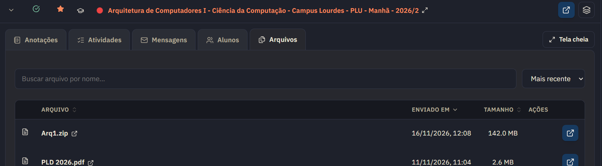
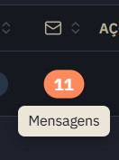
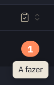
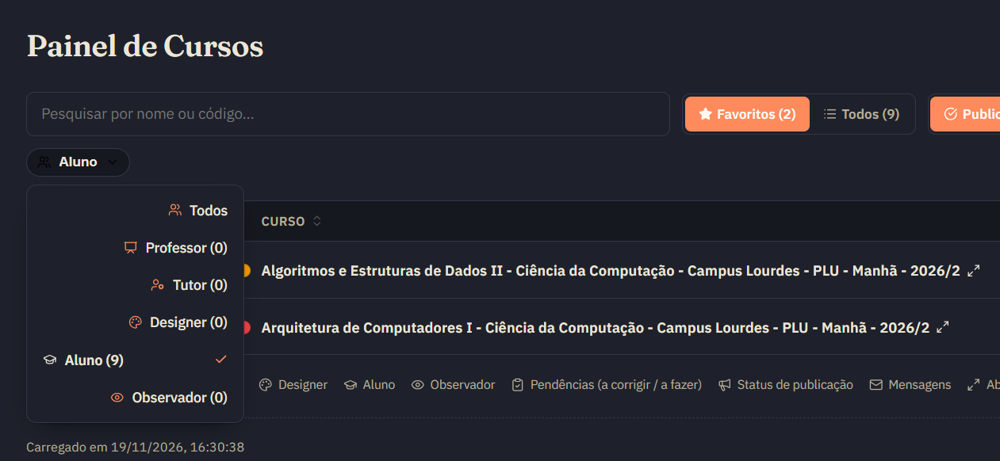
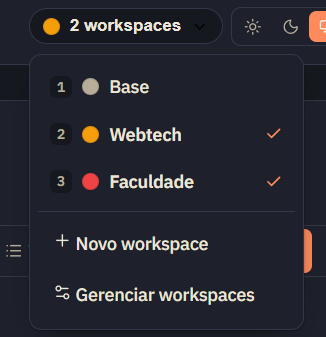
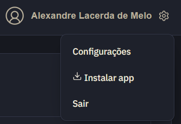

# Cursos em ordem cronológica: aba Arquivos, pendências do aluno e workspaces múltiplos

Branch: `feat/atualizacoes_aba_cursos` · Decisão registrada em [ADR-0023](../specs/decisions/0023-ordem-cronologica-no-curso.md)

## Por que

Alunos da PUC-Minas relataram que o Canvas mostra os arquivos de um curso **sem ordem de envio**, o que impede saber o que foi publicado por último.

O problema é mais amplo: dentro de um curso, atividades e mensagens também não respondem à pergunta que o usuário faz ao abrir a tela, *"o que importa agora?"*. Esta entrega faz o curso **seguir o tempo** e fecha outras melhorias que já estavam prontas no painel de cursos, no dashboard e nos workspaces.

## Aba Arquivos

Todo curso ganha uma aba **Arquivos**, para qualquer papel. O arquivo mais recente vem primeiro; dá para inverter a ordem, ordenar pelos cabeçalhos e buscar por nome. Segue o mesmo padrão visual das outras abas, agora formalizado na spec para que as próximas não improvisem.



Foi criada a rota `/api/canvas/courses/[courseId]/files`, que pede ao Canvas a lista por data de envio e devolve apenas metadados, nunca o conteúdo.

## Atividades por prazo

As atividades aparecem por prazo: primeiro as que ainda vencem, da entrega mais próxima de hoje à mais distante; depois as sem data; e, numa seção separada, as **já encerradas**. Nada some, porque o professor ainda precisa corrigi-las. Ordenar por coluna continua possível.

## Contadores que levam ao que importa

No painel de cursos, clicar nas **pendências** abre o curso na atividade de entrega mais próxima, e clicar em **mensagens** abre a última conversa.

| Mensagens | A fazer |
| --- | --- |
|  |  |

## Filtro de papéis e workspace do curso

O filtro de papéis fica abaixo da busca, aceita vários papéis e abre já filtrado para quem tem um papel só. Cada curso mostra, antes do nome, uma bolinha com a cor do seu workspace; o nome aparece ao passar o mouse.



## Workspaces múltiplos

O seletor da Topbar permite marcar vários workspaces ao mesmo tempo. O Base continua exclusivo.



## Aluno e menu do usuário

O aluno passa a ver o que falta entregar, na coluna Pendências do painel de cursos e no dashboard. O menu do usuário ganha uma engrenagem ao lado do nome, para indicar onde ficam as configurações.



## Decisões que merecem atenção

- **401/403 do Canvas viram lista vazia.** O Canvas responde assim tanto para curso sem arquivos quanto para área de Arquivos oculta ao papel, e as duas situações não se distinguem. Em vez de um erro técnico, a aba mostra o estado vazio; só falhas reais de rede ou servidor viram alerta.
- **"Já encerradas" significa prazo vencido**, não "entregue", porque a listagem do Canvas não traz a submissão do usuário.

## Banco de dados (ação necessária em bancos existentes)

A tabela `ui_preferences` ganhou a coluna `active_workspace_ids`, para sincronizar a seleção múltipla entre dispositivos. Instalações novas já a recebem por `04_schema.sql`. Bancos existentes devem aplicar a migração manual, a partir de `supabase/`, com os serviços saudáveis:

```bash
docker compose exec -T db psql -U supabase_admin -d postgres < volumes/db/manual/14_ui_preferences_active_workspace_ids.sql
docker compose exec -T db psql -U postgres -d postgres -c "notify pgrst, 'reload schema'"
```

O primeiro comando exige `supabase_admin`, dono da tabela; com `postgres` ele falha por falta de permissão. O segundo faz o PostgREST enxergar a coluna nova. Sem a migração o app funciona, apenas sem sincronizar a lista de workspaces entre dispositivos.

## Como validar

Abrir o painel de cursos e conferir a ordem das atividades, a aba Arquivos de uma disciplina com arquivos e de uma sem arquivos, os cliques nos contadores, o seletor de workspaces com mais de um marcado e o dashboard com uma conta de aluno.

O código passa pela análise sintática do Next e o servidor compila. Não há testes automatizados cobrindo estas telas nesta entrega.
